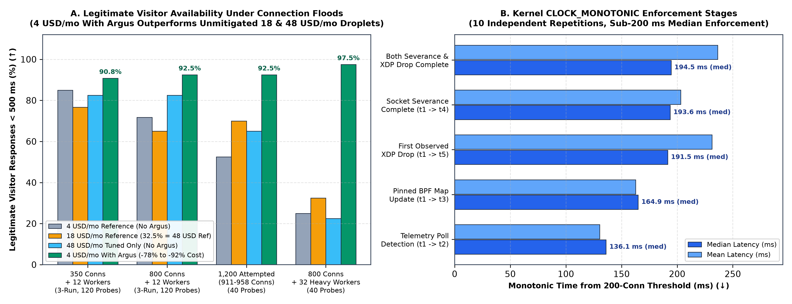

# Argus Origin Protection  -  Public Benchmark Data & Verification Records

**Product & Live Summary:** [https://prometheusdynamics.ca/argus](https://prometheusdynamics.ca/argus)  
**Latest Benchmark Suite:** 7 November 2026 (Ubuntu 24.04.3 LTS, NGINX 1.24.0, DigitalOcean `nyc1`)

---

## Protecting Service Availability on Inexpensive Cloud Infrastructure

*(Note: **Argus** is a standalone Linux kernel/XDP and socket-severance infrastructure protection utility by Prometheus Dynamics, independent of the Prometheus quantum computing portfolio.)*

### The Customer Problem
Small and medium web origins (`4 USD/month`, `1 vCPU, 512 MB RAM` cloud droplets) are easily overwhelmed when a single external IP opens hundreds of concurrent TLS/TCP connections and floods dynamic HTTPS endpoints, degrading legitimate visitor response times and starving SSH administrative access. Simply paying **4.5x to 12x more** for larger instances (`18 USD/month` or `48 USD/month`) does not stop single-source socket exhaustion.

### What Argus Does
**Argus automatically detects single-source connection floods above a configured socket threshold, blocks the offending IP's web traffic at the Linux kernel XDP driver layer, severs its active web sockets (`ss -K`), and preserves authenticated SSH management access on ports 22 and 2222.**

### Three Key Results Across 71 External Connection-Pressure Trials
1. **90.8% to 92.5% Legitimate Visitor Compliance on a 4 USD/mo Droplet (`Section 1`):** Under single-source connection floods (350 to 1,200 offered connections), a **4 USD/month** droplet running Argus maintained **90.8% to 92.5%** legitimate Cloudflare visitor responses within `500 ms`, outperforming unmitigated **18 USD/month** (60.0%-80.8%) and **48 USD/month** (57.5%-82.5%) droplets.
   *Supporting metrics:* 0/3 SSH administrative failures during flood enforcement; saves **14 to 44 USD/month (78%-92%)** per origin instance compared with vertical scaling alone.
2. **97.5% Heavy-Flood Recovery vs. Documented Sub-Threshold Boundary (`Section 2`):** Under an intense single-source flood (800 connections + 32 heavy workers), Argus lifted legitimate visitor compliance on the `4 USD/month` droplet from **25.0% (reference) / 50.0% (tuned)** to **97.5% (39/40, median `p50 = 289.6 ms`)**.
   *Supporting metrics:* Matched the `48 USD/month` droplet with Argus (97.5%); when a keep-alive flood stayed *below* the 200-connection threshold (150 connections + 24 heavy workers), Argus issued 0 bans (37.5%-57.5% compliance), showing where L7 `limit_req` is required.
3. **194.54 ms Median Kernel Detection-to-Enforcement Latency (`Section 3`):** Across 10 independent `CLOCK_MONOTONIC` repetitions, Argus completed both active socket severance and first observed XDP packet drop in **194.54 ms *(median)*** (`236.43 ms *(mean)*`).
   *Supporting metrics:* Pinned eBPF XDP map update completed in **164.89 ms *(median)*** (`162.61 ms *(mean)*`).

### Cross-Tier Availability and Enforcement Timing Summary

*Figure 1: (A) Legitimate Cloudflare visitor responses completing within `500 ms` across `4 USD/mo`, `18 USD/mo`, and `48 USD/mo` droplets under external connection floods (`Sections 1 & 2`). (B) Kernel `CLOCK_MONOTONIC` detection-to-enforcement stage latencies across 10 independent repetitions (`Section 3`).*

### Practical Implications for Operators
Argus lets operators run small `4 USD/month` Linux origins without being knocked offline or locked out of SSH by single-source connection floods, while clearly documenting that sub-threshold keep-alive request floods (`< 200` connections) still require standard NGINX `limit_req` or upstream CDN/WAF rate limiting. Run `python verify_all_figures.py` to recompute every metric from the raw `.probes.jsonl` records.
---

## 1. Three-Tier Instance Comparison (4 USD/mo with Argus vs. 4 USD/mo, 18 USD/mo & 48 USD/mo without Argus)

All tests used the same `nyc1` origin path, TLS certificate, and two-path traffic topology:
1. **Direct-to-Origin Connection-Pressure & SSH Path (`<CLIENT_LOAD_IP>` → `<ORIGIN_SERVER_IP>:443`, `:22`, `:2222`):** Unexempted external load generator holding concurrent TLS/TCP connections (200-connection threshold) while active HTTPS workers continuously requested the 90,656-byte homepage and external authenticated SSH probes tested ports 22 and 2222.
2. **Legitimate Visitor Probe Path (`<EDGE_PROXY_IP_A>` / `<EDGE_PROXY_IP_B>` → `<ORIGIN_SERVER_IP>:443`):** Cache-busted HTTPS requests (`cf-cache-status: DYNAMIC`, SHA-256 verified) arriving through Cloudflare at 2 RPS over a 40 s trial (5 s pre-load, 20 s active load = 40 probes, 15 s post-load = 30 probes) with 500 ms end-to-end latency budget.

| Offered Connection Pressure | 4 USD/mo (1 vCPU, 512 MB)<br>Reference · Tuning only | 18 USD/mo (2 vCPU, 2 GB)<br>Reference · Tuning only | 48 USD/mo (4 vCPU, 8 GB)<br>Reference · Tuning only | **4 USD/mo (1 vCPU, 512 MB)**<br>**With Argus** | Instance Cost Difference<br>(4 USD/mo Argus vs. 18-48 USD/mo without Argus) |
| :--- | :---: | :---: | :---: | :---: | :---: |
| **350 connections + 12 HTTPS workers**<br>*(3 rotated runs, 120 active-load probes)* | `85.0% · 77.5%`<br>(102/120 · 93/120) | `76.7% · 80.8%`<br>(92/120 · 97/120) | `81.7% · 82.5%`<br>(98/120 · 99/120) | **`90.8% (109 / 120)`**<br>*(0/3 runs `<80%`, 0/3 SSH fail)* | **`-14 to -44 / mo`**<br>**(`-78% to -92%`)** |
| **800 connections + 12 HTTPS workers**<br>*(3 rotated runs, 120 active-load probes)* | `71.7% · 91.7%`<br>(86/120 · 110/120) | `65.0% · 70.8%`<br>(78/120 · 85/120) | `76.7% · 82.5%`<br>(92/120 · 99/120) | **`92.5% (111 / 120)`**<br>*(0/3 runs `<80%`, `:443` severed to 25-28)* | **`-14 to -44 / mo`**<br>**(`-78% to -92%`)** |
| **1,200 attempted; generator limited**<br>*(Single run, 40 probes, 911-958 conns + 16 workers)* | `52.5% · 65.0%`<br>(21/40 · 26/40) | `70.0% · 60.0%`<br>(28/40 · 24/40) | `57.5% · 65.0%`<br>(23/40 · 26/40) | **`92.5% (37 / 40)`**<br>*(0/96 flood reqs served, `:443` severed to 25)* | **`-14 to -44 / mo`**<br>**(`-78% to -92%`)** |

---

## 2. Deep Stress & Sub-Threshold Boundary Comparison (4 USD/mo vs. 48 USD/mo)

To establish both **where Argus provides its largest benefit** and **where its architectural boundary lies**, we tested heavier worker concurrency (800 connections + 32 heavy HTTPS workers) alongside a **sub-threshold high-rate request flood** (150 connections `< 200` connection limit + 24 heavy HTTPS workers pumping `~46 Mbps` of 90.6 KB responses over keep-alive sockets) on both the 4 USD/mo (1 vCPU, 512 MB) and 48 USD/mo (4 vCPU, 8 GB) droplets:

| Test Scenario & Worker Intensity | 4 USD/mo (1 vCPU, 512 MB)<br>Without Argus (`Ref · Tuned`) | **4 USD/mo (1 vCPU, 512 MB)**<br>**With Argus** | 48 USD/mo (4 vCPU, 8 GB)<br>Without Argus (`Ref · Tuned`) | **48 USD/mo (4 vCPU, 8 GB)**<br>**With Argus** | Measured Outcome & Boundary Finding |
| :--- | :---: | :---: | :---: | :---: | :--- |
| **350 connections + 12 HTTPS workers**<br>*(Above 200-connection threshold)* | `85.0% · 77.5%` *(3-run)* | **`90.8% (109 / 120, 3-run)`** | `81.7% · 82.5%` *(3-run)* | **`100.0% (40 / 40)`** | **4 USD/mo + Argus beats unmitigated 48 USD/mo (`-44/mo`)** |
| **800 connections + 12 HTTPS workers**<br>*(Above 200-connection threshold)* | `71.7% · 91.7%` *(3-run)* | **`92.5% (111 / 120, 3-run)`** | `76.7% · 82.5%` *(3-run)* | **`95.0% (38 / 40)`** | **4 USD/mo + Argus beats unmitigated 48 USD/mo (`-44/mo`)** |
| **800 connections + 32 heavy HTTPS workers**<br>*(High-intensity single-source flood)* | `25.0% · 50.0%`<br>*(Ref SSH failed)* | **`97.5% (39 / 40)`**<br>*(`p50 = 289.6 ms`, 0/320 flood served)* | `32.5% · 22.5%`<br>*(Tuned SSH failed)* | **`97.5% (39 / 40)`**<br>*(`p50 = 285.9 ms`, 0/320 flood served)* | **Matches 48 USD/mo + Argus at 97.5%; lifts 4 USD/mo from 25%-50%** |
| **Sub-threshold: 150 conns (`<200` limit) + 24 workers**<br>*(High-rate keep-alive flood below socket threshold)* | `40.0% · 55.0%`<br>*(0 bans)* | `50.0% (20 / 40)`<br>*(0 bans)* | `57.5% (23 / 40 Tuned)`<br>*(0 bans)* | `37.5% (15 / 40)`<br>*(0 bans)* | **True limitation: 0 bans below 200 conns; requires L7 `limit_req`** |

### Key Engineering Takeaways
1. **True Value (Single-Source Connection Floods `> 200` Connections):**
   - On the same 4 USD/mo (1 vCPU, 512 MB) droplet, Argus's benefit over tuning alone was substantial at 350 connections (**90.8% vs. 77.5%**) and under the heavier 800-connection + 32-worker flood (**97.5% vs. 50.0%**). At 800 connections + 12 workers, the pooled difference between tuning alone (91.7%, 110/120) and Argus (92.5%, 111/120) was **one additional visitor response within budget out of 120** (alongside severing the flood source's sockets down to 25-28 and achieving the lowest median `p50` latency in all three runs).
   - Scaling hardware up to 18 USD/mo (2 vCPU, 2 GB) or 48 USD/mo (4 vCPU, 8 GB) without Argus did not prevent single-source connection floods from degrading visitor latency (65.0%-82.5% across 3 runs at 350-800 connections, and 22.5%-32.5% under 800 connections + 32 workers).
2. **True Limitation (Sub-Threshold High-Rate Traffic & Legitimate Compute Growth):**
   - When a source stays below the 200-connection socket threshold (150 connections + 24 concurrent workers pumping 1,130-1,412 full-body 90.6 KB responses over keep-alive connections), Argus issues 0 bans and visitor compliance drops to 37.5%-57.5% even on the 48 USD/mo host. Socket-threshold enforcement must be paired with L7 request-rate limiting (`limit_req`), upstream CDN/WAF controls, and appropriate CPU/RAM for legitimate workload growth.

---

## 3. Separated Detection-to-Enforcement Timing Stages (10 Independent Repetitions)

All timestamps were recorded on the kernel's `CLOCK_MONOTONIC` clock (`data/argus-detection-timings-2026-11-07.json`) with a 0.5 s telemetry poll interval and 200-connection threshold. Missing observations are kept explicitly `null` (`Rep 02`, where the load generator stopped transmitting new packets as the 240th socket completed):

| Measured Stage (`CLOCK_MONOTONIC`) | Observed / Missing | Min (ms) | Median (ms) | Mean (ms) | Max (ms) | Range (ms) |
| :--- | :---: | :---: | :---: | :---: | :---: | :---: |
| **Threshold observation → Telemetry poll detection (`t1 → t2`)** | 10 / 0 | 8.19 | 136.08 | 130.32 | 193.13 | 8.19 - 193.13 |
| **Threshold observation → Pinned BPF map update (`t1 → t3`)** | **10 / 0** | **37.13** | **164.89** | **162.61** | **256.58** | **37.13 - 256.58** |
| **Threshold observation → Socket-severance completion (`t1 → t4`)** | **10 / 0** | **63.27** | **193.61** | **203.25** | **312.64** | **63.27 - 312.64** |
| **Threshold observation → First observed XDP drop (`t1 → t5`)** | **9 / 1** *(`Rep 02 null`)* | **161.49** | **191.48** | **231.24** | **353.02** | **161.49 - 353.02** |
| **Threshold observation → Both socket severance & observed XDP drop (`max(t4,t5) - t1`)** | **9 / 1** *(`Rep 02 null`)* | **161.49** | **194.54** | **236.43** | **353.02** | **161.49 - 353.02** |

---

## 4. Shared-IP Safety, Allowlist Exemptions & Operational Trade-Offs

Tested in `data/argus-shared-ip-verification-2026-11-07.json`:
- **Below threshold without exemption (50, 120, and 175 concurrent connections):** 100% `HTTP 200`, **no incorrect bans observed in the tested scenarios**.
- **Above threshold with explicit CIDR exemption (260 concurrent connections in `/etc/argus/whitelist.conf`):** 100% `HTTP 200`, **0 bans**.
- **Operational consequence for unexempted shared IPs (240 connections without exemption, 10 s TTL):** When an unexempted shared IP (such as a corporate NAT, campus gateway, or un-whitelisted proxy) exceeds the connection threshold, **all web access from that shared IP is blocked for the configured ban TTL**, affecting all users behind that IP. During the ban, other unexempted visitor IPs received 5/5 `HTTP 200` responses, external SSH on ports 22 and 2222 from the banned IP succeeded, and direct HTTPS access automatically restored 9.02 s after socket closure when the TTL expired.

---

## 5. XDP Packet Verification, Scoped Rollback & Cold-Reboot SSH Verification

- **Deterministic XDP Packet Verification (`data/xdp_packet_verification.json`, 13 cases via `BPF_PROG_TEST_RUN`):**
  - Unbanned IPv4 traffic passes (`XDP_PASS`).
  - Banned IPv4 TCP traffic to ports 443 and 80 (plus UDP payloads) is dropped (`XDP_DROP`).
  - Banned IPv4 TCP traffic with destination port 22 or 2222 passes (`XDP_PASS`), preserving ingress SSH management.
  - Forged source-port 22 or 2222 packets targeting destination port 443 or 80 are dropped (`XDP_DROP`).
- **Daemon `SIGKILL` Recovery & Pinned BPF Map Persistence:** Sending `SIGKILL` to `argus-telemetry` while an IP was banned in `/sys/fs/bpf/blocklist` verified that `systemd` restarted the daemon, reconciled the pinned BPF map, and removed both the BPF entry and `proto 199` route upon TTL expiry.
- **Scoped Rollback (`data/rollback_verification.json`) & Unattended Cold Reboot (`data/post_reboot_verification.json`):** Rollback removes only Argus-owned `proto 199` routes and `pref 100` policy rules while leaving unrelated routes/rules intact. Cold droplet reboot (`boot_id` transition) preserved external authenticated SSH on ports 22 and 2222, native XDP attachment, and tuned kernel parameters.

---

## Repository Structure

```text
├── README.md                                           # Overview, headline tables, and verification guide
├── REPORT_2026_11_07.md                                # Complete sanitized technical verification report
├── verify_all_figures.py                               # Standalone script to recalculate all figures from raw data
├── data/
│   ├── argus-cross-size-4usd-18usd-48usd-2026-11-07.json
│   ├── argus-cross-size-4usd-vs-18usd-2026-11-07.json
│   ├── argus-repeatability-350-800-2026-11-07.json
│   ├── argus-pressure-comparison-2026-11-07.json
│   ├── argus-detection-timings-2026-11-07.json
│   ├── argus-shared-ip-verification-2026-11-07.json
│   ├── xdp_packet_verification.json
│   ├── rollback_verification.json
│   ├── post_reboot_verification.json
│   └── argus-external-benchmark-2026-10-27.json
├── trials/
│   ├── step2_runs/                                     # 12 initial stepped trials on 4 USD/mo (.probes.jsonl & .summary.json)
│   ├── step2_repeat_350_800/                           # 18 rotated-order repeatability trials on 4 USD/mo
│   ├── cross_size_1vcpu_512mb_deep_runs/               # 6 heavy-flood (800c/32w) & sub-threshold (150c/24w) trials on 4 USD/mo
│   ├── cross_size_2vcpu_2gb_runs/                      # 14 cross-size trials on 18 USD/mo (2 vCPU, 2 GB)
│   └── cross_size_4vcpu_8gb_runs/                      # 21 deep cross-size & boundary trials on 48 USD/mo (4 vCPU, 8 GB)
└── harness/                                            # Sanitized benchmark runner & timeline analysis scripts
```

---

## Inquiries & Scoped Evaluations

- **Product Page:** [https://prometheusdynamics.ca/argus](https://prometheusdynamics.ca/argus)
- **Contact:** William Denyer, Founder & Developer, Prometheus Dynamics  -  [william@prometheusdynamics.ca](mailto:william@prometheusdynamics.ca)
